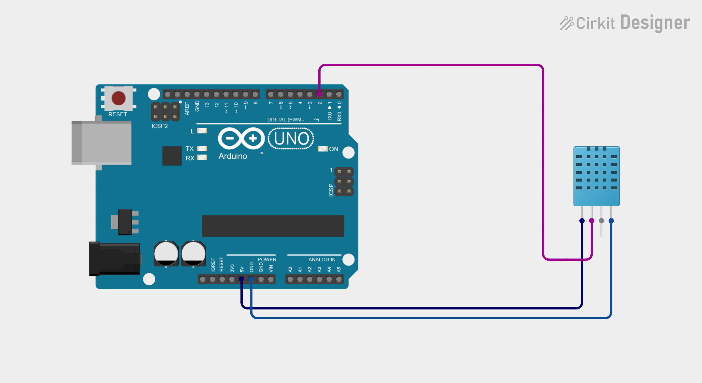
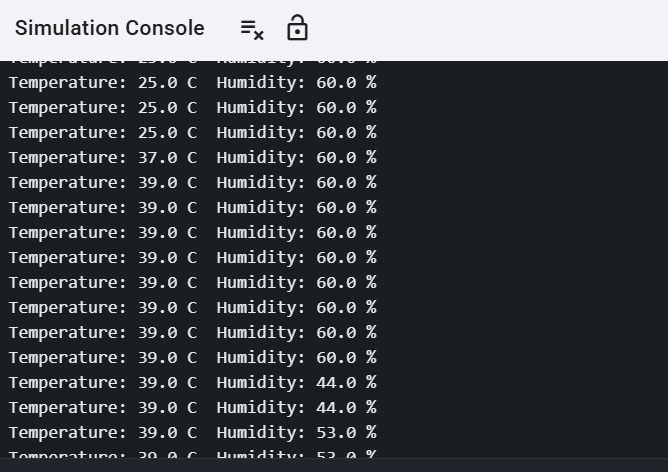

# CodeAlpha Internship Tasks

## Task 1: IoT Applications in Healthcare Monitoring
[Read the Task 1 report](<TASK1(IOT Report).md>)

## Task 2: Tinkercad Project
[View my Tinkercad project](https://www.tinkercad.com/things/aIQnSHYzugT-codealphatask2)

## Task 3: IoT Prototype - Temperature & Humidity Monitoring System
An Arduino system that reads temperature and humidity with a DHT11 sensor.

- [Cirkit Designer project](https://app.cirkitdesigner.com/project/62f66e15-bfb1-4382-b1bb-fd96eda1d20a)
- [Code](task3.ino)

**Circuit diagram**

**Output**

